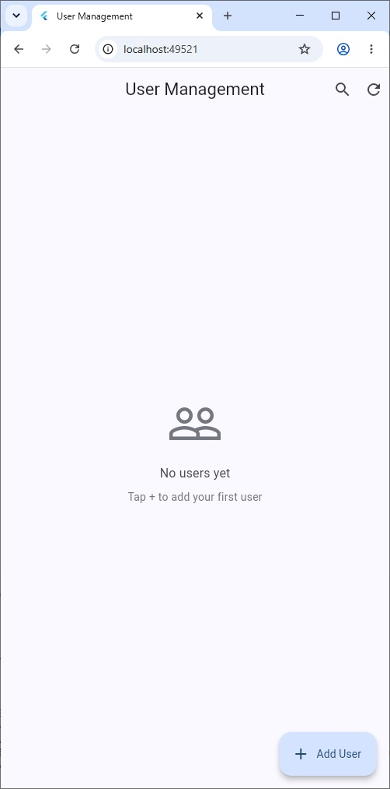
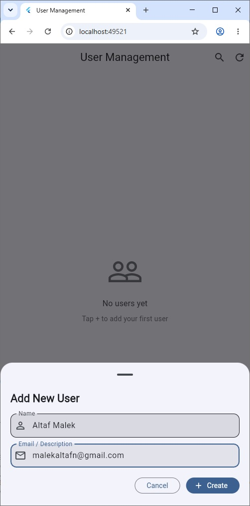
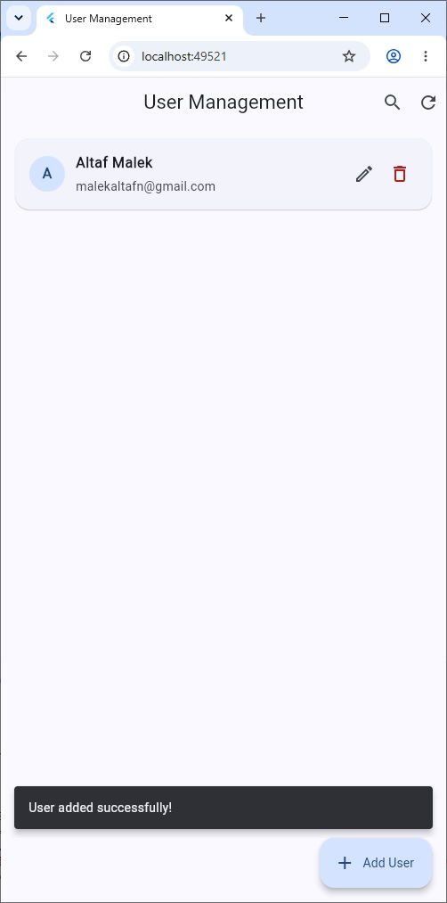

# User Management Flutter Application

A modern, cross-platform Flutter application demonstrating full SQLite CRUD (Create, Read, Update, Delete) operations with Material 3 design.

---

## Screenshots

| Empty State | Add / Edit User Form | User List & Feedback |
| :---: | :---: | :---: |
|  |  |  |

---

## Features

- **Cross-Platform SQLite**: Seamless database initialization across Web (WASM/IndexedDB), Desktop (Windows, macOS, Linux via SQLite FFI), and Mobile (Android, iOS).
- **Material 3 Design**: Clean typography, tonal elevation, modern rounded cards, and adaptive Light/Dark mode.
- **Full CRUD Support**:
  - **Create**: Add new user records with input validation.
  - **Read**: View users with initial avatar badges and formatted metadata.
  - **Update**: Edit existing user details via bottom sheet modal.
  - **Delete**: Safe deletion with confirmation dialog and undo capability.
- **Live Search & Filter**: Real-time filtering by user name or email/description directly from the app bar.
- **Responsive States**: Clean loading indicator and friendly empty state illustrations.
- **Type-Safe Architecture**: Clean `UserItem` data model and cached database singleton helper.

---

## Tech Stack

- **Framework**: [Flutter](https://flutter.dev/) (Channel stable, Material 3)
- **Language**: [Dart](https://dart.dev/)
- **Database**:
  - [`sqflite`](https://pub.dev/packages/sqflite) (Mobile)
  - [`sqflite_common_ffi`](https://pub.dev/packages/sqflite_common_ffi) (Desktop & Tests)
  - [`sqflite_common_ffi_web`](https://pub.dev/packages/sqflite_common_ffi_web) (Web)
- **Icons**: [`cupertino_icons`](https://pub.dev/packages/cupertino_icons) & Material Icons

---

## Getting Started

### Prerequisites

- [Flutter SDK](https://docs.flutter.dev/get-started/install) (`>= 3.3.0`)
- Chrome, Windows Desktop, Android Studio, or Xcode (depending on target platform)

### Installation

1. Clone or download the repository:
   ```bash
   git clone <repository-url>
   cd flutter_sqflite
   ```

2. Fetch dependencies:
   ```bash
   flutter pub get
   ```

3. Run the application:
   - **Web**:
     ```bash
     flutter run -d chrome
     ```
   - **Windows**:
     ```bash
     flutter run -d windows
     ```
   - **Android / iOS**:
     ```bash
     flutter run
     ```

### Running Tests & Analysis

- **Static Analysis**:
  ```bash
  flutter analyze
  ```
- **Automated Tests**:
  ```bash
  flutter test
  ```

---

## Project Structure

```
flutter_sqflite/
├── lib/
│   ├── main.dart        # Application entry, Material 3 UI, search & state
│   └── sql_helper.dart  # Type-safe UserItem model & SQLite CRUD service
├── test/
│   ├── sql_helper_test.dart  # Unit tests for SQLite database operations
│   └── widget_test.dart      # UI & interaction smoke tests
├── pubspec.yaml         # Dependencies and project configuration
├── screen1.jpg          # Empty state screenshot
├── screen2.jpg          # Add user modal screenshot
└── screen3.jpg          # User list screenshot
```
